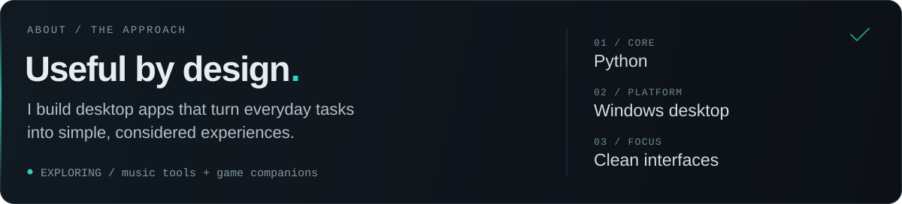
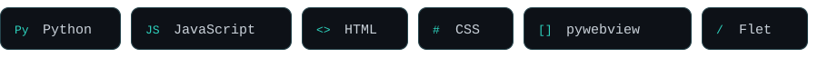
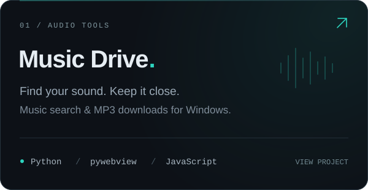
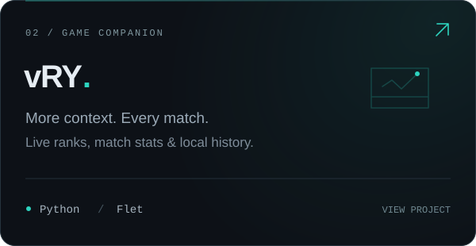

  

  <a href="https://github.com/RinoNRC?tab=repositories">Projects</a>
  &nbsp; / &nbsp;
  <a href="https://t.me/rinonrc">Telegram</a>

  

### Toolkit

  

### Selected work

  
  

vRY is based on [VALORANT-rank-yoinker](https://github.com/zayKenyon/VALORANT-rank-yoinker). Not affiliated with Riot Games.

  

  Less noise. More building.

